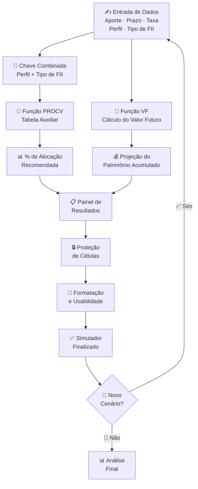
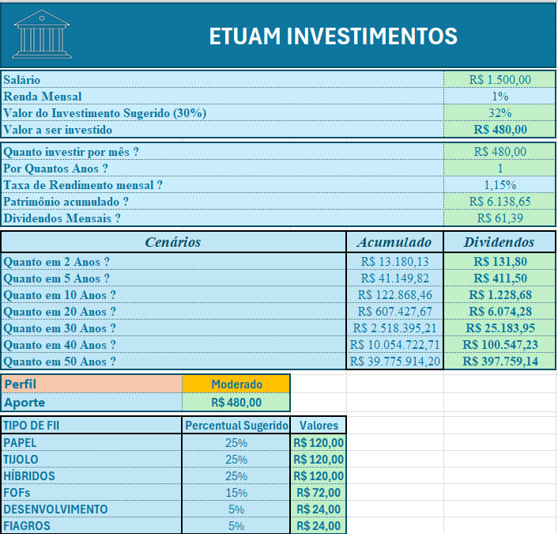

# 🏢 Simulador de Investimentos em Fundos Imobiliários (FIIs)

<div align="center">


**Ferramenta interativa para simulação e projeção de investimentos em Fundos Imobiliários**

[🧾 Funcionalidades](#-funcionalidades-implementadas) • [🧮 Função VF](#-cálculo-do-valor-futuro--função-vf) • [🔎 PROCV](#-tabela-de-apoio-e-procv) • [🔒 Proteção](#-proteção-e-controle-da-planilha) • [🚀 Resultados](#-principais-resultados)

</div>

---

## 📌 Sobre o Projeto

Projeto desenvolvido em **Excel** com o objetivo de simular investimentos em **Fundos de Investimento Imobiliário (FIIs)**, permitindo ao usuário analisar diferentes cenários de aporte, prazo, rentabilidade e perfil de investidor.

> A solução foi construída para **facilitar a tomada de decisão**, automatizando cálculos de projeção financeira e recomendações de alocação por meio de fórmulas, tabelas auxiliares e funções de busca.

---

## 🎯 Objetivo

Desenvolver uma **ferramenta interativa** capaz de:

<div align="center">

| # | 🎯 Funcionalidade | 📋 Descrição |
|---|---|---|
| 1 | 💰 **Simular Investimentos** | Projeta aportes mensais em FIIs ao longo do tempo |
| 2 | 📈 **Projetar Valor Futuro** | Calcula patrimônio acumulado com capitalização composta |
| 3 | 🎯 **Sugerir Alocação** | Recomenda percentuais por perfil × tipo de fundo |
| 4 | 🔄 **Múltiplos Cenários** | Atualiza projeções instantaneamente ao alterar parâmetros |
| 5 | 📊 **Apoiar Decisões** | Automatiza análises financeiras complexas |

</div>

---

## 🧾 Funcionalidades Implementadas

### ✍️ Campos para Entrada de Dados

O usuário preenche os seguintes parâmetros para iniciar a simulação:

```
┌──────────────────────────────────────────────────────────────┐
│               📋 PAINEL DE ENTRADA DE DADOS                 │
├──────────────────────────────┬───────────────────────────────┤
│  💵 Aporte Mensal            │  R$ ___________               │
│  📅 Prazo da Aplicação       │  ___ meses                    │
│  📈 Taxa de Rendimento       │  ___% ao mês                  │
│  👤 Perfil do Investidor     │  [ Conservador / Moderado /   │
│                               │    Agressivo ]                │
│  🏢 Tipo de FII              │  [ Tijolo / Papel / Híbrido ] │
└──────────────────────────────┴───────────────────────────────┘
         ↓ Todos os cálculos atualizam automaticamente ↓
```

---

### 🧮 Cálculo do Valor Futuro — Função `VF()`

Foi utilizada a função financeira nativa do Excel para projetar o patrimônio acumulado:

```excel
=VF(taxa; nper; pgto; [vp]; [tipo])
```

| 🔢 Argumento | 📋 Descrição | 🔗 Campo no Simulador |
|---|---|---|
| `taxa` | Taxa de rendimento por período | 📈 Taxa de Rendimento (%) |
| `nper` | Número de períodos (meses) | 📅 Prazo da Aplicação |
| `pgto` | Valor do aporte periódico | 💵 Aporte Mensal |
| `vp` | Valor presente inicial | 💰 Saldo inicial (opcional) |
| `tipo` | Pagamento no início ou fim | 🔄 Padrão: fim do período |

> ✅ A função considera **capitalização composta**, refletindo com precisão o crescimento exponencial do patrimônio ao longo do tempo.

#### 📈 Exemplo de Projeção

```
  Patrimônio
  Acumulado
  ▲
  │                                            ●  ← Valor Futuro
  │                                       ●
  │                                  ●
  │                            ●
  │                      ●
  │               ●
  │        ●
  │  ●
  └──────────────────────────────────────────► Tempo (meses)
     6    12    24    36    48    60    72
```

---

### 🔎 Tabela de Apoio e PROCV

Foi criada uma **planilha auxiliar** para armazenar as regras de recomendação de alocação por perfil de investidor.

#### 🗝️ Chave Combinada

A tabela utiliza uma **chave composta** para localizar o percentual de alocação recomendado:

```
  Chave = Perfil do Investidor + Tipo de FII
```

<div align="center">

| 👤 Perfil | 🏢 Tipo de FII | 🔑 Chave Combinada | 📊 % Alocação |
|---|---|---|:---:|
| 🛡️ Conservador | 🧱 Tijolo | `Conservador_Tijolo` | **60%** |
| 🛡️ Conservador | 📄 Papel | `Conservador_Papel` | **30%** |
| 🛡️ Conservador | 🔀 Híbrido | `Conservador_Híbrido` | **10%** |
| ⚖️ Moderado | 🧱 Tijolo | `Moderado_Tijolo` | **40%** |
| ⚖️ Moderado | 📄 Papel | `Moderado_Papel` | **40%** |
| ⚖️ Moderado | 🔀 Híbrido | `Moderado_Híbrido` | **20%** |
| 🚀 Agressivo | 🧱 Tijolo | `Agressivo_Tijolo` | **30%** |
| 🚀 Agressivo | 📄 Papel | `Agressivo_Papel` | **30%** |
| 🚀 Agressivo | 🔀 Híbrido | `Agressivo_Híbrido` | **40%** |

</div>

#### 🔎 Função `PROCV()`

```excel
=PROCV(chave_combinada; tabela_auxiliar; coluna_resultado; 0)
```

| ✅ Benefício | 📋 Descrição |
|---|---|
| ⚡ **Consulta automática** | Localiza o percentual sem intervenção manual |
| 🎯 **Redução de erros** | Elimina digitação incorreta de percentuais |
| 📊 **Dinamismo** | Atualiza ao alterar perfil ou tipo de fundo |
| 🔄 **Instantâneo** | Resultado imediato ao mudar qualquer parâmetro |

---

### 🔒 Proteção e Controle da Planilha

Para preservar a **integridade dos cálculos** e evitar alterações acidentais:

<div align="center">

| 🔒 Proteção Aplicada | 🎯 Finalidade |
|---|---|
| 🔐 **Travamento de células com fórmulas** | Impede edição acidental dos cálculos |
| 🛡️ **Proteção de valores de referência** | Preserva taxas e parâmetros-base |
| 🔑 **Bloqueio de parâmetros críticos** | Mantém consistência dos resultados |
| ✅ **Células editáveis delimitadas** | Apenas os campos de entrada ficam livres |

</div>

```
┌────────────────────────────────────────────────────────┐
│                 🔒 MAPA DE PROTEÇÃO                   │
├─────────────────────────┬──────────────────────────────┤
│  ✏️ EDITÁVEL             │  🔒 BLOQUEADO              │
├─────────────────────────┼──────────────────────────────┤
│  💵 Aporte Mensal       │  🧮 Fórmula VF()            │
│  📅 Prazo               │  🔎 Fórmula PROCV()         │
│  📈 Taxa                │  📊 Tabela Auxiliar         │
│  👤 Perfil              │  🔢 Resultados Calculados   │
│  🏢 Tipo de FII         │  📐 Parâmetros de Referência│
└─────────────────────────┴──────────────────────────────┘
```

---

### 🎨 Formatação e Usabilidade

Foram aplicadas técnicas de formatação para **melhorar a experiência do usuário**:

<div align="center">

| 🎨 Elemento | 🖌️ Tratamento Aplicado |
|---|---|
| 🎨 **Paleta de Cores** | Cores padronizadas por seção e tipo de dado |
| 🔤 **Tipografia** | Fontes ajustadas para hierarquia visual clara |
| 📏 **Dimensionamento** | Células ajustadas para leitura e usabilidade |
| 🖼️ **Layout** | Organização visual intuitiva e fluida |
| 📋 **Bordas e Destaques** | Separação visual das áreas funcionais |
| ✅ **Legibilidade** | Contraste e alinhamento otimizados |

</div>

---

## 🗺️ Pipeline de Desenvolvimento



---

## 🧪 Testes e Validação

Foram realizados testes com diferentes combinações de parâmetros para verificar o correto funcionamento:

<div align="center">

| 🧪 Cenário Testado | ✅ Resultado |
|---|---|
| 📈 Diferentes taxas de rendimento | Cálculos corretos em todos os casos |
| 💵 Variações nos aportes mensais | Projeções atualizadas instantaneamente |
| 📅 Diferentes horizontes de tempo | Capitalização composta funcionando corretamente |
| 👤 Troca de perfil do investidor | PROCV retornou a alocação correta |
| 🏢 Diferentes categorias de FIIs | Chave combinada identificada com precisão |

</div>

---

## 📸 Demonstração

> 📌 

---

## 🚀 Principais Resultados

<div align="center">

| ✅ Resultado | 📋 Descrição |
|---|---|
| 🏢 **Simulador de FIIs** | Ferramenta completa para projeção de investimentos imobiliários |
| 🧮 **Função VF** | Projeções automáticas com capitalização composta |
| 🎯 **Recomendações por Perfil** | Alocação personalizada por perfil × tipo de fundo |
| 🔎 **PROCV Automatizado** | Consultas instantâneas sem intervenção manual |
| 🔒 **Planilha Segura** | Células protegidas para garantir integridade dos dados |

</div>

---

## 📊 Recursos Utilizados

<div align="center">

| 🛠️ Recurso | 📌 Uso no Projeto |
|---|---|
|  | Plataforma principal do simulador |
| -FFD700?logo=cashapp&logoColor=black) | Projeção de valor futuro com juros compostos |
| -00897B?logo=microsoftexcel&logoColor=white) | Busca automática de percentuais de alocação |
|  | Base de regras de recomendação por perfil |
|  | Segurança e integridade dos cálculos |
|  | Análise de múltiplos cenários de investimento |

</div>

---

## 🎓 Competências Desenvolvidas

- 🏦 **Matemática Financeira** — juros compostos, valor futuro e capitalização
- 📈 **Simulação de Investimentos** — análise de cenários com múltiplos parâmetros
- 🧮 **Modelagem de Planilhas** — estrutura funcional, auxiliar e de resultados
- 📗 **Excel Avançado** — funções financeiras, de busca e proteção de dados
- ⚡ **Automação de Cálculos** — atualização instantânea por parâmetros dinâmicos
- 💰 **Funções Financeiras** — domínio da função `VF()` e suas variáveis
- 🔎 **Funções de Busca** — aplicação prática do `PROCV()` com chave composta
- 🔒 **Proteção de Dados** — travamento seletivo de células críticas
- 🎯 **Análise de Cenários** — comparação de diferentes perfis e horizontes

---

## 🔗 Referências

- 📗 [Função VF — Microsoft Docs](https://support.microsoft.com/office/vf-funcao-vf)
- 🔎 [Função PROCV — Microsoft Docs](https://support.microsoft.com/office/procv-funcao-procv)
- 🏢 [O que são FIIs — B3](https://www.b3.com.br/pt_br/produtos-e-servicos/negociacao/renda-variavel/fundos-de-investimentos/fii)
- 💰 [Juros Compostos — Calculadora do Cidadão](https://www3.bcb.gov.br/CALCJUROS)
- 🎓 [DIO — Digital Innovation One](https://www.dio.me)

---

## 📚 Observação

> 📖 Este projeto foi desenvolvido para **fins acadêmicos e de aprendizado**, com foco na aplicação prática de conceitos de **matemática financeira**, modelagem de planilhas e simulação de investimentos em Fundos Imobiliários (FIIs). Os percentuais de alocação utilizados são exemplos didáticos e não constituem recomendação de investimento.

---

## 👤 Autor

<div align="center">

**Desenvolvido com 💛 para fins acadêmicos — simulação financeira e modelagem avançada em Excel.**

[](https://www.dio.me)
[](https://github.com)
[](https://linkedin.com)

</div>

---

<div align="center">

⭐ **Caso tenha gostado do projeto, considere deixar uma estrela no repositório!** ⭐

`🏢 FIIs` • `💰 Investimentos` • `📗 Excel` • `🧮 Função VF` • `🔎 PROCV` • `📈 Simulação Financeira` • `🎯 Planejamento`

</div>
